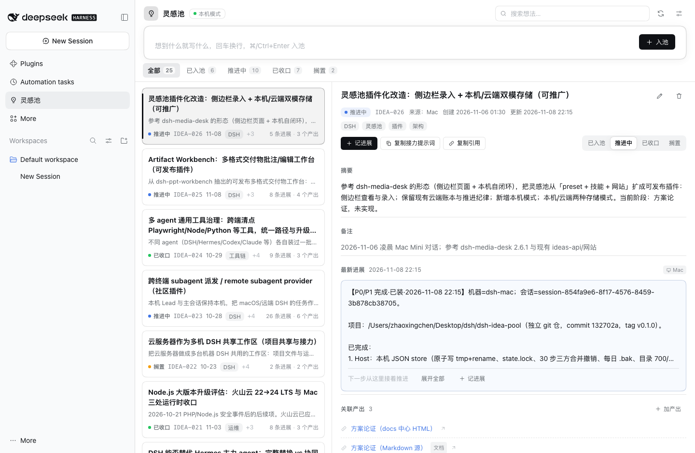
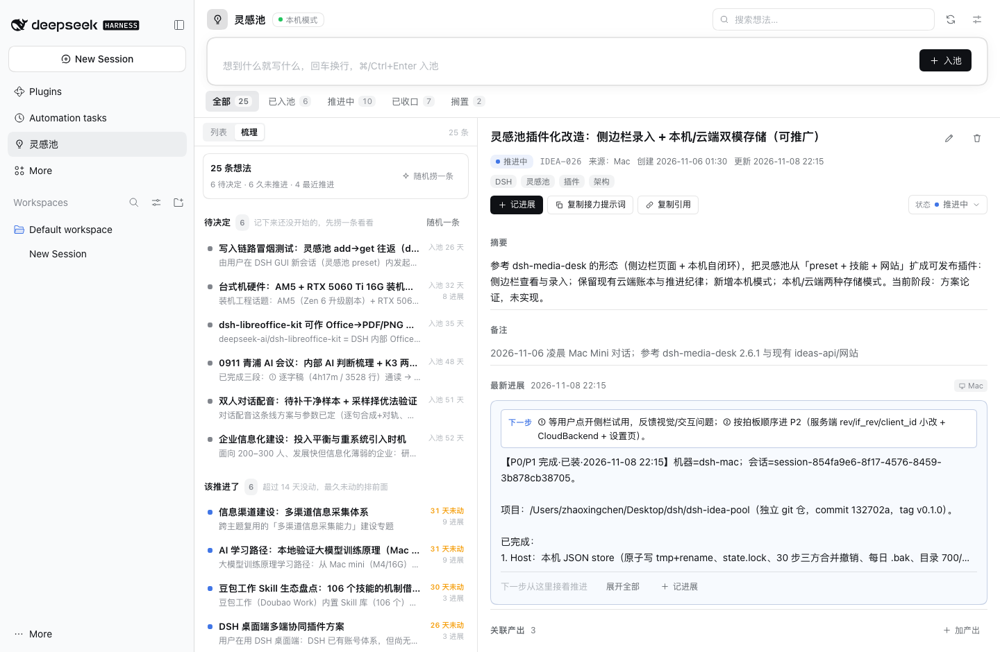
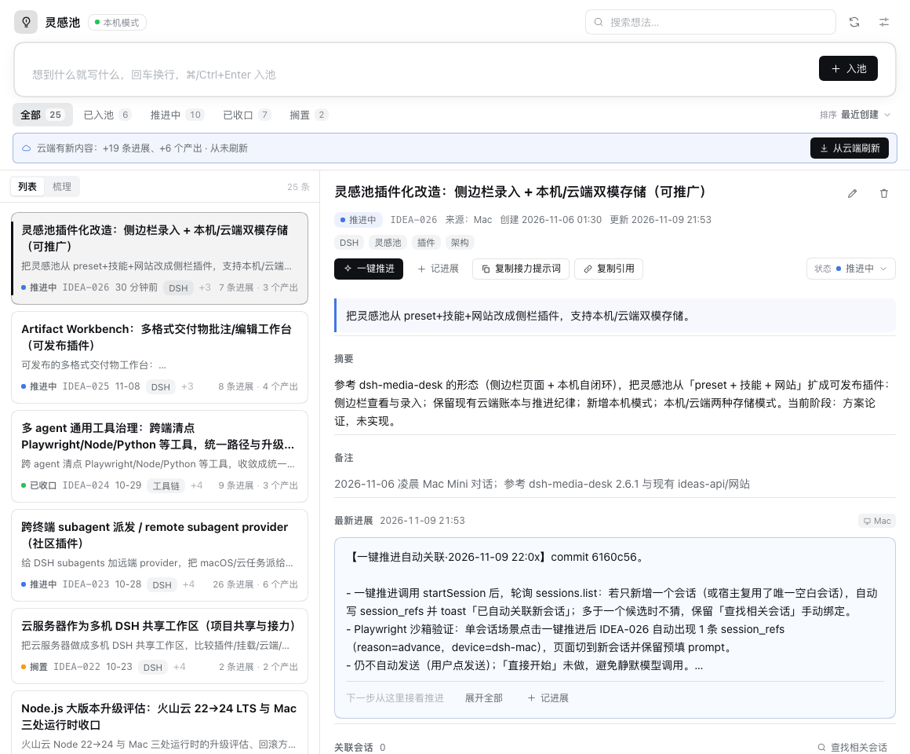
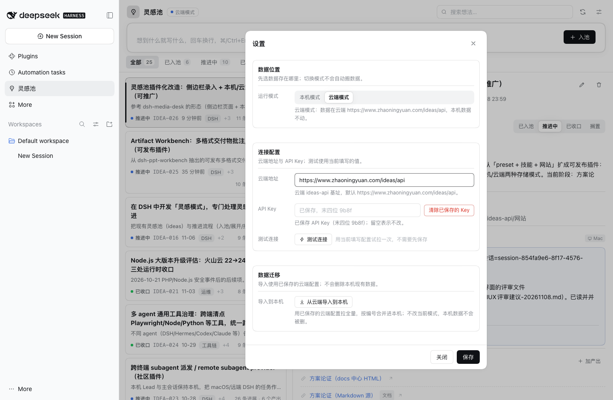

**English** · [简体中文](README.md)

<p align="center">
  
</p>

<h1 align="center">Idea Pool</h1>

<p align="center"><b>A sidebar idea workbench for DeepSeek Harness: capture fast, local-first, cloud optional.</b></p>

<p align="center">
  
  <a href="LICENSE"></a>
  
  <a href="https://www.npmjs.com/package/dsh-idea-pool"></a>
</p>

## Why

Ideas usually die while you wait to "write them down later": chat windows scroll away, note apps are too far, and todo lists do not fit thoughts that are still forming. Idea Pool puts capture → review → advance → close into the DeepSeek Harness (DSH) sidebar. One line to capture, the raw text kept verbatim, append-only progress, and output links attached to the same idea. Data stays on your machine by default — no account, no telemetry. Bring your own backend only if you want to share ideas across devices.

## What it is

A page that lives in the DSH sidebar:

- Always-visible capture bar; raw text saved verbatim; ⌘/Ctrl+Enter to add.
- List with status filters, search and sorting; a **Review** view buckets ideas into *to decide / stale / in progress*, plus a random-pick button.
- Detail pane with raw text, summary, progress timeline, output links, linked DSH sessions, and status switching.
- **One-click advance**: opens a new session with an advance prompt prefilled (never auto-sent) and links it back when there is exactly one new session.
- An `idea_pool` agent tool (add / list / get / progress / link / status / export) sharing the same service as the UI.

Two storage modes:

| | Local mode (default) | Cloud mode (optional) |
| --- | --- | --- |
| Where data lives | `$DSH_HOME/idea-pool/state.json` | your own ideas-api backend |
| Setup required | none | base URL + API key |
| Works offline | yes | no |
| Shared across devices | no | yes (same backend ledger) |
| Data leaves the machine | no | yes, whatever you write is sent to that backend |

## Screenshots

<p align="center"></p>
<p align="center"></p>
<p align="center"></p>
<p align="center"></p>

## Install

Requires DeepSeek Harness `0.2.2-rc.1` or newer within `0.2.x`. Full steps and troubleshooting: [`INSTALL.md`](INSTALL.md).

### Option 1: npm package / plugin page

Open DSH → Plugins → Add plugin → enter `dsh-idea-pool@0.3.1`; or:

```bash
dsh plugin --profile desktop add dsh-idea-pool@0.3.1
```

npm package page: https://www.npmjs.com/package/dsh-idea-pool

### Option 2: local source / tgz

```bash
# repository root
npm ci && npm run build
dsh plugin --profile desktop add "file:$PWD"      # or file:/abs/path/dsh-idea-pool-0.3.1.tgz

# from a DSH session you can also use the plugin manager tool:
# action=install_bundle, target=<absolute path to this directory>
```

Restart DSH after install; the "Idea Pool" entry appears in the sidebar. **Local mode works with zero configuration** — no cloud URL needed.

## Configuration

Open Settings from the panel header. Stored in `$DSH_HOME/idea-pool/settings.json` (mode 600; the API key is write-only and never returned to the browser).

| Setting | Default | Description |
| --- | --- | --- |
| `mode` | `local` | `local` or `cloud`; switching modes does not move data |
| `device` | per platform: `dsh-mac` / `dsh-win` / `dsh` | written to the `source` field of ideas and progress entries |
| `cloud.base` | empty | your own ideas-api base URL, `http(s)://...`, usually ending in `/api`; **no third-party address is preset** |
| `cloud.apiKey` | empty | stored in local `settings.json`; the UI only exposes `hasKey` and the last four characters |
| `DSH_HOME` (env) | `~/.dsh` | where the `idea-pool/` data directory lives |

## Local mode and data

- Data file: `$DSH_HOME/idea-pool/state.json` (directory 700, file 600); a daily `state.json.bak` and a `state.lock` live next to it.
- Local mode supports a 30-step undo with three-way merge (undoing does not wipe later changes).
- Settings show the storage path, let you change the device ID, and export all data as JSON.
- Deleting `state.json` clears the local idea pool.
- Backup/migration: copy `state.json` or use "Export JSON" in settings.

## Cloud mode (optional)


1. Prepare an **ideas-api v2 compatible** backend (`rev` / `if_rev` / `client_id`). If you do not have one, use the bundled lightweight server:

   ```bash
   # edit compose.yaml and replace IDEAS_API_TOKEN with your own long random token first
   docker compose up -d          # or: python3 server/ideas_api.py
   ```

2. Settings → Run mode → Cloud mode.
3. Fill in the cloud base URL (e.g. `http://your-host:8794/api`) and the API key (for the bundled server, the same `IDEAS_API_TOKEN`).
4. Click "Test connection", then save.

Cloud writes use `rev` / `if_rev` optimistic locking: if another device edited first you get a 409 and the UI asks you to refresh and retry. Undo is not supported in cloud mode.

**Local ↔ cloud boundary**: the local ledger may be an older snapshot imported from the cloud. In local mode a status bar shows how far behind the cloud you are (new ideas / progress / links), and "Refresh from cloud" merges that content **one-way** into local (merge by idea number, dedupe progress/outputs by id, keep local-only content, undoable). **New local content is never written back to the cloud — this is not two-way sync.** You can also pull cloud content into local with `scripts/import-cloud.mjs` (`--base` is required; see the header comment).

## Privacy and security

- Local mode does not use the network; data stays in `$DSH_HOME/idea-pool/`.
- Cloud mode is only enabled after you configure it. When writing, it sends the idea raw text, title, summary, gist, tags, progress content, output titles/links, source device and timestamps to **the backend you configured**; credentials travel in the `X-API-Key` request header. Review a third-party backend's privacy policy before using it.
- The cloud key is stored only in local `settings.json` (600); the API returns `hasKey` and the last four characters only, and keys never appear in logs, errors or exports.
- All HTTP routes go through DSH connection auth; write requests additionally check `sec-fetch-site`.
- No accounts, no telemetry. See [`SECURITY.md`](SECURITY.md) for the data boundary and vulnerability reporting.

## Uninstall

```bash
dsh plugin --profile desktop remove dsh-idea-pool
```

Data is kept; delete `$DSH_HOME/idea-pool/` to remove it completely.

## Development and tests

```bash
npm ci
npm test                 # host unit tests (node:test; 126 cases currently)
npm run build            # client/ → client.js (esbuild; commit the artifact)
npm run watch            # rebuild while editing client/
scripts/dev-sandbox.sh   # start a web build with an isolated DSH_HOME (needs dsh CLI on PATH)
```

- Node.js `>=20`.
- Changes to `lib/` or `index.js` need a DSH restart (or remove + add to reload); client-only changes need `npm run build` and a page refresh.
- CI: `.github/workflows/ci.yml` runs `npm ci` → `npm test` → `npm run build` → `npm pack --dry-run` on Node 22/24.
- Interface and data contract: [`CONTRACT.md`](CONTRACT.md); version history: [`CHANGELOG.md`](CHANGELOG.md).

## Layout

```
index.js + lib/          host: local store, Local/Cloud engines, continuity, /idea-pool routes, idea_pool tool
client/ → client.js      client sidebar page (React, bundled by esbuild)
server/                  self-hostable SQLite ideas-api v2 compatible server + Dockerfile
deploy/                  PostgreSQL migration SQL for ideas-api v2 / v3
docs/                    screenshots, ideas-api notes, compatibility audit, release checklist
scripts/                 build, isolated sandbox, cloud → local import
test/                    node:test
CONTRACT.md              host/client interface and data contract (v0.3.1)
```

## Known limitations

- No undo in cloud mode; the undo entry is hidden there.
- Cloud list returns up to 500 items on first page; pagination is future work.
- No two-way sync: "Refresh from cloud" merges cloud → local only.
- JSON export in Electron has not been verified on a real click-through.
- Single user only; collaboration and permissions are out of scope.
- Targets DSH `0.2.x`; re-run compatibility checks before moving to `0.3.x`.

## License

[MIT](LICENSE) © Zhaoxingchen
