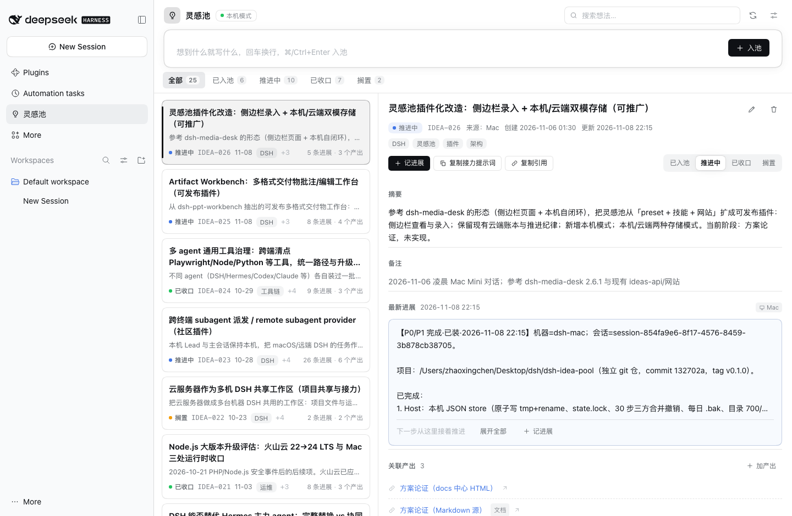
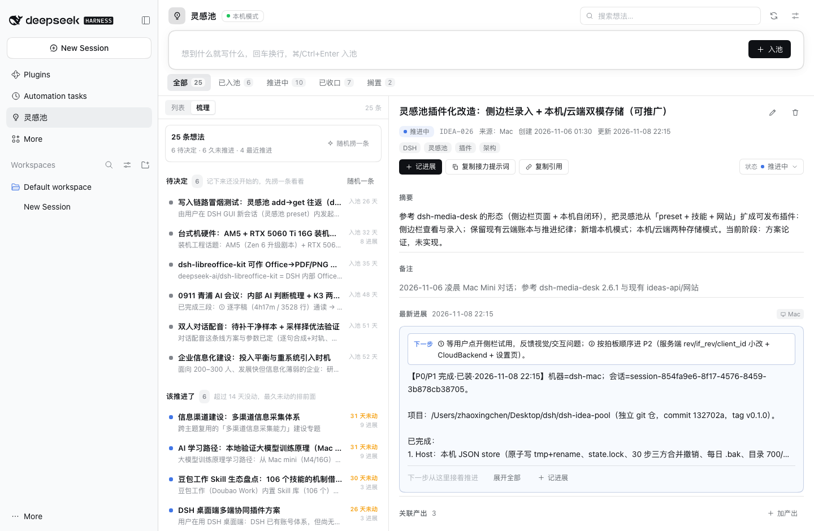
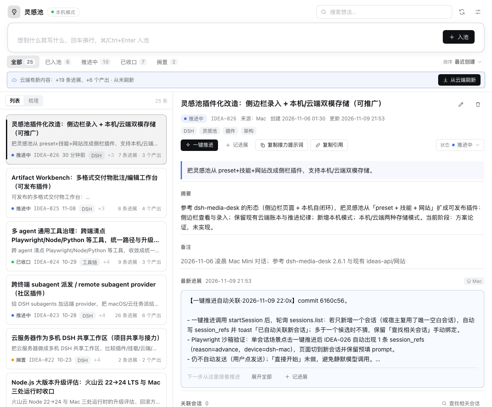
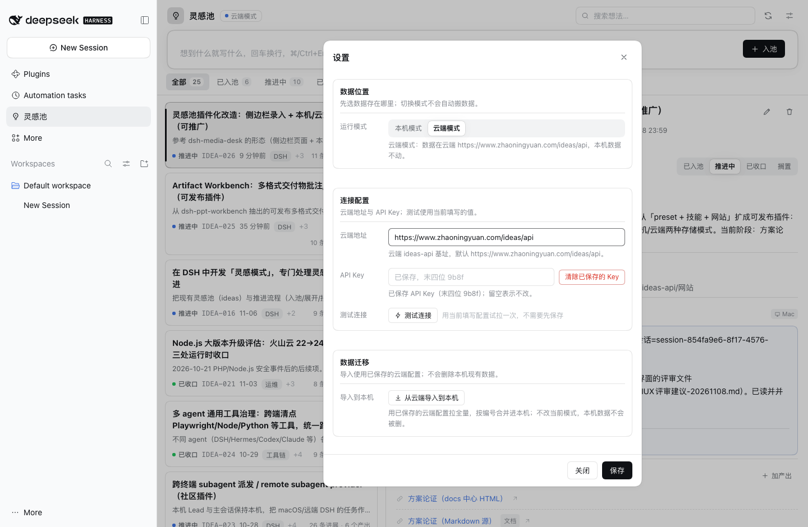

[English](README.en.md) · **简体中文**

<p align="center">
  
</p>

<h1 align="center">灵感池 · Idea Pool</h1>

<p align="center"><b>DeepSeek Harness 的侧栏灵感工作台：随手记，本机优先，云端可选。</b></p>

<p align="center">
  
  <a href="LICENSE"></a>
  
</p>

## 为什么做这个

想法往往死于「等会儿再记」：聊天窗口会滚走，笔记软件太远，待办列表又不适合还没想清楚的东西。灵感池把「记下来 → 看一眼 → 推进一步 → 收口」塞进 DSH 侧栏：一句话入池，原文逐字保留，进展追加式记录，产出链接挂在同一条想法上。数据默认只在本机，不注册账号、不做遥测；想多设备接力时再自己接一个后端。

## 它是什么

一个装在 DeepSeek Harness 侧栏里的页面：

- 顶部常驻录入条，原文逐字保存，⌘/Ctrl+Enter 入池；
- 列表按状态筛选、搜索、排序；「梳理」视图按 **待决定 / 该推进了 / 正在推进** 分桶，还能随机捞一条；
- 详情里看原文、摘要、进展时间线、关联产出、关联 DSH 会话，并切换状态；
- **一键推进**：打开新会话并预填推进提示词（不自动发送），会话唯一时自动回填关联；
- 会话内还有 `idea_pool` agent 工具（add / list / get / progress / link / status / export），与界面共用同一个服务。

两种存储模式：

| | 本机模式（默认） | 云端模式（可选） |
| --- | --- | --- |
| 数据在哪 | `$DSH_HOME/idea-pool/state.json` | 你自己配置的 ideas-api 后端 |
| 需要配置 | 无 | 基址 + API Key |
| 离线可用 | 是 | 否 |
| 多设备共用 | 否 | 是（同一个后端账本） |
| 数据出本机 | 否 | 是：写入的内容会发到该后端 |

## 截图

<p align="center"></p>
<p align="center"></p>
<p align="center"></p>
<p align="center"></p>

## 安装

要求 DeepSeek Harness `0.2.2-rc.1` 及以上的 `0.2.x`。完整步骤与排障见 [`INSTALL.md`](INSTALL.md)。

### 方式一：npm 包 / 插件页

发布到 npm 后，在 DSH 打开「插件」页 → 添加插件 → 输入包名 `dsh-idea-pool`；或：

```bash
dsh plugin --profile desktop add dsh-idea-pool
```

### 方式二：本地源码 / tgz

```bash
# 仓库根目录
npm ci && npm run build
dsh plugin --profile desktop add "file:$PWD"      # 或 file:/绝对路径/dsh-idea-pool-0.3.1.tgz

# 也可以在 DSH 会话里用插件管理工具：
# action=install_bundle, target=<本目录绝对路径>
```

安装后侧栏出现「灵感池」；桌面版装完重开一次应用。**本机模式零配置可用**，不需要填云端地址。

## 配置

设置入口：灵感池面板右上角「设置」。配置落在 `$DSH_HOME/idea-pool/settings.json`（600，密钥只落盘、不回传浏览器）。

| 配置项 | 默认 | 说明 |
| --- | --- | --- |
| 运行模式 `mode` | `local` | `local` 本机模式 / `cloud` 云端模式；切换模式不会自动搬数据 |
| 设备标识 `device` | 按平台：`dsh-mac` / `dsh-win` / `dsh` | 写进想法与进展的 `source` 字段，跨机接力时定位来源 |
| 云端地址 `cloud.base` | 空 | 你自己的 ideas-api 基址，必须以 `http(s)://` 开头、一般以 `/api` 结尾；**不预置任何第三方地址** |
| 云端 Key `cloud.apiKey` | 空 | 存在本机 `settings.json`；界面只显示 `hasKey` 与末四位 |
| `DSH_HOME`（环境变量） | `~/.dsh` | 决定 `idea-pool/` 数据目录位置 |

## 本机模式与数据

- 数据文件：`$DSH_HOME/idea-pool/state.json`（目录 700、文件 600）；同目录有每日 `state.json.bak` 与写锁 `state.lock`。
- 本机模式支持 30 步撤销（三方合并：撤销这一步不会抹掉之后别人的改动）。
- 设置里可以查看存储路径、改设备标识、导出全部 JSON。
- 删除 `state.json` 等于清空本机灵感池。
- 备份/迁移：复制 `state.json`，或用设置里的「导出 JSON」。

## 云端模式（可选）


1. 准备一个 **ideas-api v2 兼容**后端（`rev` / `if_rev` / `client_id`）。没有现成后端时用仓库自带轻量版：

   ```bash
   # 先把 compose.yaml 里的 IDEAS_API_TOKEN 换成自己的随机长串
   docker compose up -d          # 或：python3 server/ideas_api.py
   ```

2. 设置 → 运行模式 → 云端模式；
3. 填云端地址（例：`http://你的主机:8794/api`）与 API Key（自建版即 `IDEAS_API_TOKEN`）；
4. 点「测试连接」确认条数与延迟，保存。

云端写入用 `rev` / `if_rev` 乐观锁：别的端先改过会返回 409，界面提示刷新后重试；云端模式暂不支持撤销。

**本机 ↔ 云端边界**：本机账本可能是较早从云端导入的快照。本机模式顶部会显示它落后云端多少（云端多出的想法 / 进展 / 产出），点「从云端刷新」可把这部分**单向**并进本机（按编号合并、进展/产出按 id 去重、本机独有内容保留，刷新可撤销）。**本机的新内容不会回写云端，这不是双向同步。** 需要把云端已有内容拉到本机，也可以用 `scripts/import-cloud.mjs`（`--base` 必填，见文件头注释）。

## 隐私与安全

- 本机模式不联网，数据只在 `$DSH_HOME/idea-pool/`。
- 云端模式只会在你显式配置后启用，写入时会把想法原文、标题、摘要、一句话摘要、标签、进展内容、产出标题/链接、来源设备与时间等发送到**你配置的那个后端**；服务端凭据以 `X-API-Key` 请求头发送。使用第三方后端前请确认其隐私政策。
- 云端 Key 只存本机 `settings.json`（600）；接口只回 `hasKey` 与末四位，日志、错误、导出都不含密钥。
- 所有 HTTP 路由都过 DSH 的 connection 鉴权；写请求再查 `sec-fetch-site`。
- 不引入账号体系，不做遥测。漏洞报告与更细的数据边界见 [`SECURITY.md`](SECURITY.md)。

## 卸载

```bash
dsh plugin --profile desktop remove dsh-idea-pool
```

数据不会被删除；彻底清理时手动删除 `$DSH_HOME/idea-pool/`。

## 开发与测试

```bash
npm ci
npm test                 # Host 单元测试（node:test，当前 126 个用例）
npm run build            # client/ → client.js（esbuild，产物需提交）
npm run watch            # 边改 client/ 边构建
scripts/dev-sandbox.sh   # 隔离 DSH_HOME 起 web 版，不碰 ~/.dsh（需要 dsh CLI 在 PATH）
```

- Node.js `>=20`。
- `lib/`、`index.js` 改动需要重启 DSH（或 remove + add 让 Loader 重新加载）；只改 `client/` 时重新 `npm run build` 并刷新页面。
- CI：`.github/workflows/ci.yml` 在 Node 22/24 上跑 `npm ci` → `npm test` → `npm run build` → `npm pack --dry-run`。
- 接口与数据模型约定见 [`CONTRACT.md`](CONTRACT.md)；版本记录见 [`CHANGELOG.md`](CHANGELOG.md)。

## 目录结构

```
index.js + lib/          Host：本机 store、双引擎（Local/Cloud）、双模连续性、/idea-pool 路由、idea_pool 工具
client/ → client.js      Client：侧栏页面（React，esbuild 打包）
server/                  可自建的 SQLite ideas-api v2 兼容服务端 + Dockerfile
deploy/                  PostgreSQL 版 ideas-api 的迁移 SQL（v2 / v3）
docs/                    截图、ideas-api 增量说明、兼容审计、发布清单
scripts/                 构建、隔离沙盒、云端→本机导入
test/                    node:test
CONTRACT.md              Host/Client 接口与数据契约（v0.3.1）
```

## 已知限制

- 云端模式暂不支持撤销；撤销入口在云端模式隐藏。
- 云端列表首屏最多 500 条；更多数据需要分页（后续版本）。
- 不做双向同步：本机「从云端增量刷新」是单向合并（云端 → 本机）。
- Electron 内导出 JSON 的落盘行为未做真机确认。
- 只支持单用户；多人协作与权限体系不在本版范围。
- DSH 目标版本是 `0.2.x`；升级到 `0.3.x` 前需要重新做兼容验证。

## License

[MIT](LICENSE) © Zhaoxingchen
